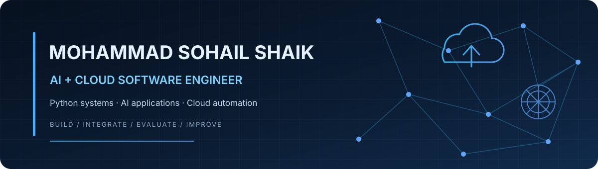

# Mohammad Sohail Shaik

**AI + Cloud Software Engineer** · Heilbronn, Germany

I build practical Python software across **AI applications, backend systems and cloud automation**. My interests include LLM-powered workflows, retrieval systems, software integration and reliable engineering practices.

I am completing an **M.Sc. in Software Engineering at Hochschule Heilbronn** and looking for junior, graduate, internship and working-student opportunities in Germany across AI, cloud and software engineering.

[LinkedIn](https://www.linkedin.com/in/mohammad-sohail-shaik/) · [GitHub](https://github.com/Sochjvmbcht) · [Email](mailto:mohammadsohailshaik46@gmail.com)

---

## Engineering focus

| Domain | Tools and technologies |
|---|---|
| **Programming** | Python, SQL |
| **AI & machine learning** | LLM applications, RAG, Ollama, Qdrant, Scikit-learn, Pandas |
| **Backend & integration** | FastAPI, Flask, REST APIs |
| **Cloud & operations** | AWS (EC2, S3; currently deepening hands-on skills), Linux |
| **Delivery & infrastructure** | Git, GitHub, GitHub Actions, Docker, Terraform; Kubernetes fundamentals |
| **Analytics** | Power BI, DAX |

I distinguish between technologies I use independently, tools I have applied in projects, and areas I am actively learning. Project READMEs describe the implementation and scope.

## Featured projects

### [AI-Assisted Debugging Evaluation](https://github.com/Sochjvmbcht/ai-assisted-debugging-evaluation-2)
An independently developed Python framework for evaluating LLM-assisted debugging approaches. Tested with real LLM responses and mock/synthetic cases.

**Focus:** Python · LLM evaluation · debugging workflows · test design

### [CloudOps Slackbot — AWS Automation](https://github.com/Sochjvmbcht/cloudops-slackbot-aws-automation)
A Slack-integrated Python/Flask project for selected AWS EC2 and S3 operations. Developed using tutorials and extended through independent modifications, with hands-on testing using AWS Free Tier resources.

**Focus:** Python · Flask · Slack integration · AWS EC2 · Amazon S3

### [Heart Disease Prediction](https://github.com/Sochjvmbcht/Heart-Disease-Prediction-using-Random-Forest)
A machine-learning project using the Cleveland Heart Disease dataset. Implements Random Forest and other machine-learning models with evaluation metrics.

**Focus:** Python · Pandas · Scikit-learn · classification · model evaluation

### More projects
- [Amazon Electronics Product Sales Analysis](https://github.com/Sochjvmbcht/Amazon-Electronic-product-sales-analysis) — data analysis and visualisation.
- [Paper & Ink Bookstore](https://github.com/Sochjvmbcht/paper-and-ink-bookstore) — responsive bookstore frontend.
- [Credit Card Fraud Detection](https://github.com/Sochjvmbcht/Credit-Card-Fraud-Detection) — machine-learning classification project; methodology and evaluation are being reviewed.

---

## Experience

**Software Engineering — Systems & Integration | RoboTUM / TU Munich**
- Worked on Python-based software integration and connecting software components.
- Explored LLM use cases in robotics and AI-enabled system workflows.

**Junior Cloud Engineer | Tata Consultancy Services**
- Worked with Python scripting and automation to support cloud operations and workflows.

## Education

**M.Sc. Software Engineering** — Hochschule Heilbronn, Germany  
Thesis phase

**B.Tech. Computer Science and Engineering** — Yogi Vemana University, India  
CGPA: 8.39/10

---

## Currently developing

- Deeper hands-on AWS cloud engineering and deployment.
- Kubernetes and container orchestration practice.
- Reliable CI/CD, testing and infrastructure workflows.
- A university RAG / LLM Matching & Optimization project using Python, Qdrant, Ollama and FastAPI. This project is currently local and will be published after code, configuration and documentation review.

---

## Get in touch

I welcome conversations about junior engineering roles, graduate opportunities, internships and working-student positions in Germany.

**LinkedIn:** [mohammad-sohail-shaik](https://www.linkedin.com/in/mohammad-sohail-shaik/)  
**Email:** [mohammadsohailshaik46@gmail.com](mailto:mohammadsohailshaik46@gmail.com)

---

Built with a focus on practical engineering, clear documentation, reproducible work and honest technical claims.
